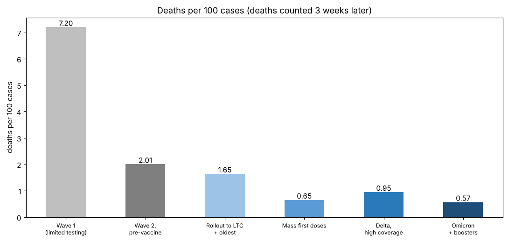
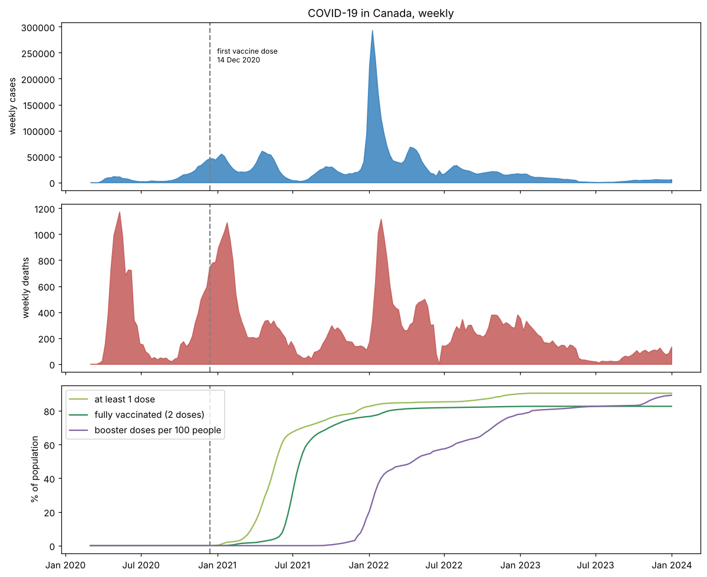
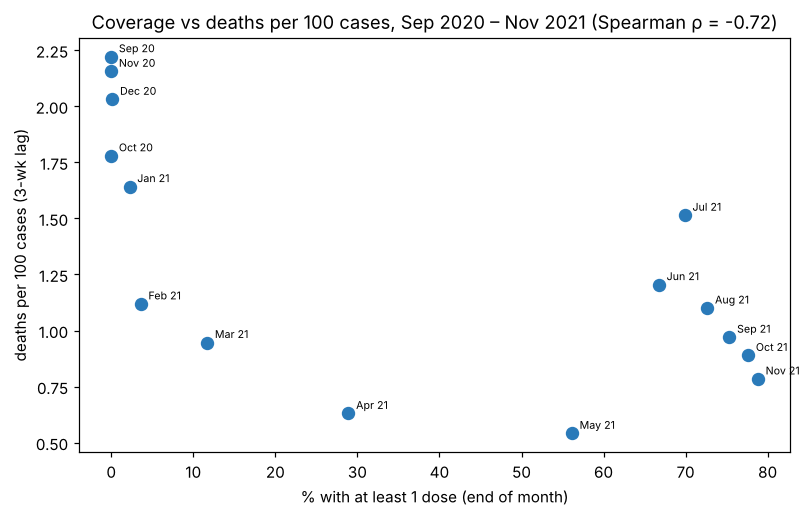

# COVID-19 in Canada — Trends and Vaccination Impact

A time-series analysis of COVID-19 cases, deaths and vaccination in Canada (2020–2023) in Python. It asks one question: **did the share of cases that ended in death fall as vaccination coverage rose?**



## Key findings

| Period | Deaths per 100 cases (3-week lag) | ≥1 dose at end |
|---|---|---|
| Wave 1, Mar–Aug 2020 (limited testing) | 7.20 | 0% |
| Wave 2, Sep–mid-Dec 2020, pre-vaccine | 2.01 | 0% |
| Rollout to long-term care + oldest, mid-Dec 2020–Feb 2021 | 1.65 | 3.6% |
| Mass first doses, Mar–May 2021 | 0.65 | 56% |
| Delta wave, Jul–Nov 2021 | 0.95 | 79% |
| Omicron + boosters, Dec 2021–Jun 2022 | 0.57 | 85% |

- From wave 2 to the spring 2021 mass-vaccination period, deaths per 100 cases fell by about **two-thirds (2.01 → 0.65)**, even though spring 2021 had more reported cases.
- From September 2020 to November 2021, months with higher first-dose coverage had fewer deaths per case (**Spearman ρ = −0.72**).
- Delta pushed the ratio up slightly (0.95), but it stayed well below pre-vaccine levels.
- Wave 1's 7.2 is inflated by very limited testing early in the pandemic.



## Approach

1. **Data prep:** Canada's counts are reported weekly, so daily records were summed into a weekly series; vaccination percentages were carried forward.
2. **Lagged case fatality ratio:** each week's cases were compared with deaths three weeks later, because deaths follow infection.
3. **Period comparison:** six periods defined by pandemic wave and Canada's rollout (long-term care and oldest first; second doses delayed in spring 2021, so first-dose coverage is the better measure for 2021).
4. **Correlation:** month-level Spearman rank correlation between first-dose coverage and deaths per case.



## Limitations

This is observational, national-level data: it shows association, not proof that vaccines caused the drop. Treatments, variants and testing policies changed over the same time, and reported cases undercount real infections (especially from 2022). A stronger follow-up would compare age-specific death rates for vaccinated and unvaccinated people using provincial data.

## Data

[Our World in Data — COVID-19 dataset](https://github.com/owid/covid-19-data) (CC BY 4.0), Canada rows only, saved in `data/canada_covid.csv`. Cases and deaths come from the WHO; vaccinations from official Canadian sources.

## How to run

```bash
pip install -r requirements.txt
jupyter notebook notebooks/covid19_canada_vaccination.ipynb
```

## Repository structure

```
├── data/canada_covid.csv                          Canada subset of OWID data
├── notebooks/covid19_canada_vaccination.ipynb     full analysis
├── images/                                        charts and the period table (CSV)
├── requirements.txt
└── README.md
```

*Author: Mohammed Mudabbir Ahmed · B.Sc. Data Science, Memorial University of Newfoundland · [LinkedIn](https://www.linkedin.com/in/mmudabbirahmed)*
